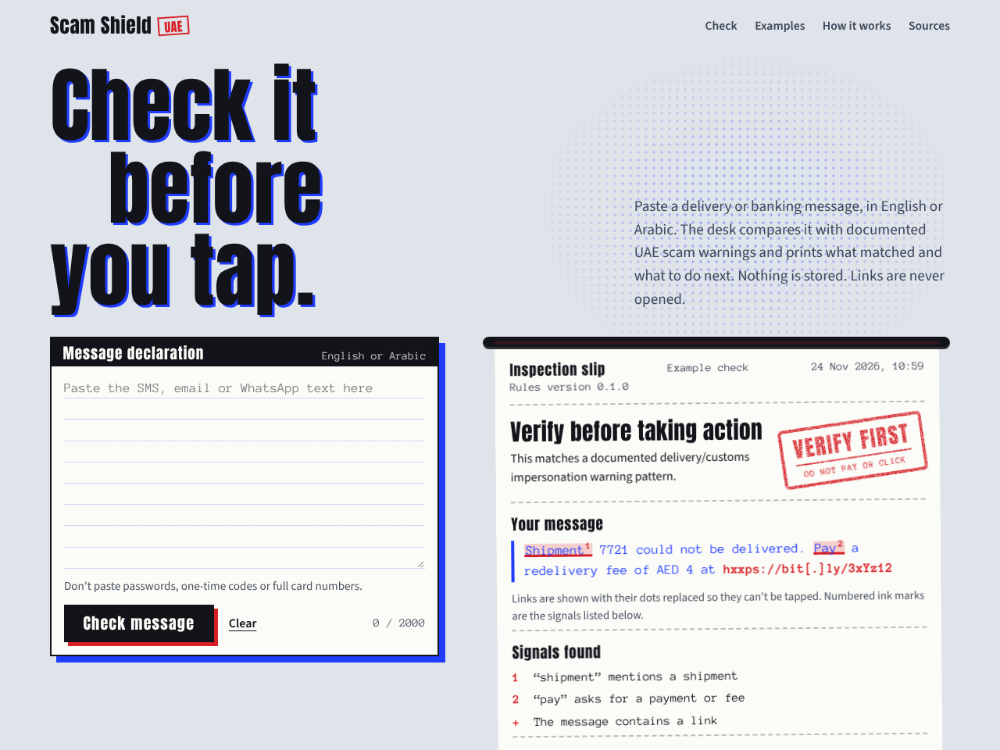
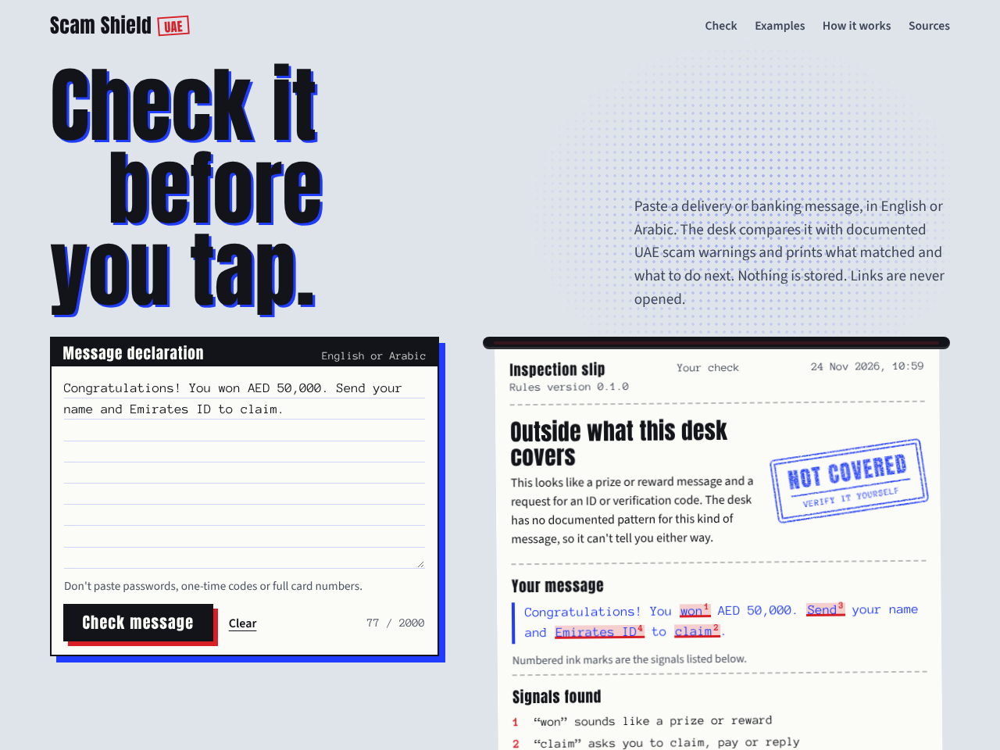
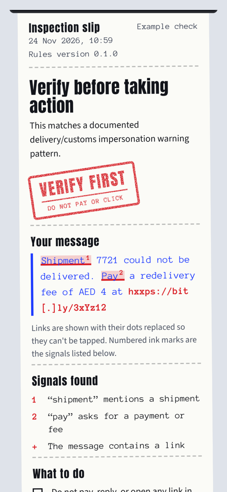
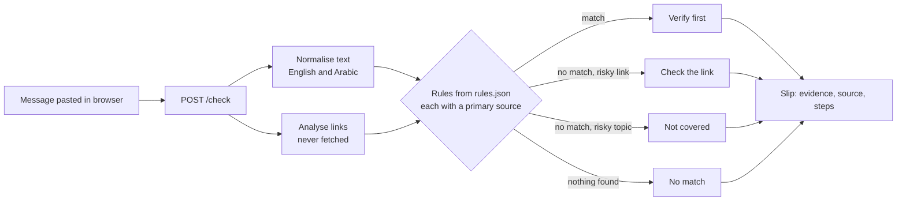

<div align="center">

# 🛡️ Scam Shield UAE

**Paste a suspicious delivery or banking message, in English or Arabic.<br>Get a source-linked explanation of what matches a documented UAE scam warning, and what to do next.**

[](https://github.com/NimraNadeemkhan/scam-shield-uae/actions/workflows/ci.yml)


[**Live demo**](#live-demo) · [The problem](#the-problem) · [Tech stack](#tech-stack) · [Skills](#skills-this-project-demonstrates) · [Quickstart](#quickstart) · [Evaluation](#evaluation)



</div>

## Live demo

> 🚧 _Coming soon._ Deploy guide: [docs/deploy.md](docs/deploy.md)

## At a glance

| | |
|---|---|
| **What it is** | A web app, REST API and CLI that checks a message against documented UAE scam warnings |
| **Who it is for** | Anyone in the UAE holding a message that says "your parcel is on hold" or "your account is blocked" |
| **What makes it different** | Every result cites an official source, and the tool refuses to guess |
| **Languages** | Python, JavaScript, HTML, CSS, JSON, YAML, TOML |
| **Built by** | [Nimra Nadeem](https://github.com/NimraNadeemkhan) |

## The problem

Fake messages that pretend to be couriers, customs authorities or banks are a documented problem in the UAE. Abu Dhabi Customs, DHL and the Central Bank of the UAE have all published warnings (see [Sources](#sources)). But those warnings are spread across separate pages, and nobody has time to read them while a suspicious message is sitting on their phone.

General-purpose scam checkers often return a bare verdict with no evidence, and most are built for English. This project takes a different approach:

| Principle | What it means here |
|---|---|
| **Evidence, not a score** | Every rule cites the official page it comes from, with publication and review dates. |
| **Honest verdicts** | It never says "this is a scam" and never treats "no match" as "safe". |
| **English and Arabic** | One engine handles both, including Arabic spelling variants. |
| **Private by design** | The message is analysed in memory. It is never stored, logged or sent back, and links are never opened. |

## The four outcomes

| Stamp | Meaning |
|---|---|
| 🟥 **Verify first** | The message matches a documented warning pattern. Shows the evidence, the source and the steps to take. |
| 🟧 **Check the link** | No message pattern matched, but a link has warning signs (lookalike domain, shortener, raw IP). |
| 🟦 **Not covered** | The message looks like a prize, fine, investment or code request. The desk has no documented rule for it yet, so it says so instead of guessing. |
| ⬜ **No match** | Nothing suspicious found. This is not a guarantee, and the slip says so. |

## The interface

The site is a customs **inspection desk**. You hand in a message, a scan light sweeps the form, and the result prints as a receipt-style slip. Matching signals are inked in one by one, links are defanged in front of you, and a rubber stamp lands with the verdict. Motion switches off for visitors who prefer reduced motion.

<div align="center">

| Not covered | Phone |
|:---:|:---:|
|  |  |

</div>

Fonts are bundled so it looks the same everywhere: [Anton](https://fonts.google.com/specimen/Anton), [Anonymous Pro](https://fonts.google.com/specimen/Anonymous+Pro) and [Source Sans 3](https://fonts.google.com/specimen/Source+Sans+3), all under the SIL Open Font License. Licence files are in `src/scamshield/web/static/fonts/`.

## Tech stack

| Language / format | Used for |
|---|---|
| **Python 3.10+** | Rules engine, text normalisation, URL analysis, REST API, CLI, rule validator, evaluator, tests |
| **JavaScript** (vanilla, no framework) | API calls, safe DOM building, highlighting, animation timing |
| **HTML5 and CSS3** | Accessible, responsive page; print, ink and stamp animation; `clip-path` and `mask`; dark mode; `prefers-reduced-motion` |
| **JSON and JSON Schema** | Rules, topics, templates and brand data, validated by a schema in CI |
| **YAML** | GitHub Actions CI and the Render deploy blueprint |
| **TOML** | Packaging (`pyproject.toml`) |

**Libraries and tools:** FastAPI, Pydantic, Uvicorn, jsonschema, pytest, httpx, GitHub Actions, Render.

## Skills this project demonstrates

| Skill | Where to look |
|---|---|
| **Backend and API design** | `src/scamshield/api.py`: request validation, structured responses, rate limiting, error handling |
| **Security thinking** | Strict Content-Security-Policy, security headers, results rendered as text (never HTML), links defanged and never fetched, no logging of user input |
| **Data modelling and validation** | `rules.json` + JSON Schema + semantic checks (unique IDs, source-domain allowlist, no future dates) that fail CI |
| **Testing** | 80+ tests: unit, API, rule validation, and a golden-case regression suite with strict `xfail` for known limitations |
| **Honest evaluation** | `python -m scamshield.evaluate` reports precision, recall and F1 per category and states that the cases are synthetic |
| **Multilingual text handling** | `normalize.py`: Arabic hamza, ta marbuta, diacritic and tatweel folding, Arabic-Indic digits, zero-width characters |
| **Front-end craft** | Hand-built UI with no framework: accessible, responsive, animated, with reduced-motion and dark-mode support |
| **DevOps** | CI matrix across Python 3.10, 3.12 and 3.13, one-service deploy blueprint, packaged fonts and data |
| **Product judgment** | Four cautious verdicts, "not covered" instead of false reassurance, sources shown with every result |

## How it works



1. **Evidence-linked rules** (`src/scamshield/data/rules.json`). Each rule has signal groups and cites a primary source: publisher, URL, publication date, date checked and review date. Rules are data, not hard-coded logic.
2. **Rules are validated in CI** (`python -m scamshield.validate`): schema, unique IDs, valid templates, source host on a primary-domain allowlist, no future dates. A stale review date only warns, so the build doesn't break just because time passed.
3. **Passive URL analysis.** Flags shorteners, IP hosts, suspicious TLDs, `user@host` tricks and lookalikes of known official domains. Official domains suppress link-based rules to avoid false alarms.
4. **Topic router** (`topics.json`). Recognises the kind of message (prize, fine, code request, investment, money transfer) so the desk can say "not covered". It cites no source and makes no scam claim.
5. **Guidance, not a score.** Each result carries concrete next steps from `templates.json`.

## Quickstart

Requires Python 3.10+.

```bash
git clone https://github.com/NimraNadeemkhan/scam-shield-uae.git
cd scam-shield-uae
pip install -e ".[dev]"
```

**Run the website and API**

```bash
uvicorn scamshield.api:app
# website:  http://127.0.0.1:8000
# API docs: http://127.0.0.1:8000/docs
```

**Check a message from the command line**

```bash
python -m scamshield "Your parcel is on hold. Update your delivery information: http://dhl-parcel-uae.top/track"
```

**Run the quality checks**

```bash
python -m scamshield.validate   # rules: schema, sources, dates
python -m scamshield.evaluate   # golden cases: precision / recall / F1
python -m pytest                # full test suite
```

> **Windows tip:** if `pip` or script activation is blocked by your system policy, use `python -m pip ...` and call tools as `python -m ...`, as shown above.

## API

`POST /check` with `{"message": "..."}` (1 to 2000 characters, 30 requests per minute per client).
Other routes: `GET /rules` (every rule with its source) and `GET /health`.

<details>
<summary><b>Example response</b></summary>

```json
{
  "verdict": "verify",
  "verdict_label": "Verify before taking action",
  "summary": "This matches a documented delivery/customs impersonation warning pattern.",
  "categories": ["delivery"],
  "matches": [{ "rule_id": "DEL-002", "title": "...", "why": "...", "matched_indicators": [], "source": { "publisher": "DHL Express UAE", "url": "https://...", "checked": "2026-11-22" } }],
  "url_indicators": [{ "url": "hxxps://bit[.]ly/3xYz12", "flags": ["shortener"] }],
  "recommended_actions": ["Do not pay, reply, or open any link in the message."],
  "official_route": "Open the courier's official site or app manually.",
  "disclaimer": "Informational guidance only. ..."
}
```

`verdict` is one of `verify`, `caution`, `out_of_scope`, `no_match`.

</details>

## Evaluation

```bash
python -m scamshield.evaluate
```

Latest run on 36 golden cases:

| Category | Positive cases | TP | FP | FN | Precision | Recall | F1 |
|---|---|---|---|---|---|---|---|
| Delivery | 7 | 6 | 0 | 1 | 1.00 | 0.86 | 0.92 |
| Banking | 5 | 4 | 1 | 1 | 0.80 | 0.80 | 0.80 |
| Job and visa | 5 | 5 | 0 | 0 | 1.00 | 1.00 | 1.00 |

> **Read these numbers carefully.** The cases are synthetic and were written by the same person who wrote the rules, from the same advisories. This is a regression suite and a sanity check, **not** a measure of real-world detection. A held-out set of real, redacted messages (never used to write rules) is the next evaluation milestone. Until then the only claim made is: *recognises selected documented UAE scam patterns*.

<details>
<summary><b>Known limitations</b> (tested, not hidden)</summary>

<br>

Each limitation is marked `known_limitation` in the golden file and run as a strict `xfail`, so the suite tells us if a change fixes one by accident.

| Case | What happens | Why |
|---|---|---|
| `DEL-P07` | "Pay AED 5 customs fee to release it" with no link: no match | The cited advisories describe link-based patterns |
| `BNK-P05` | "Reply with the code sent to your phone": answered "Not covered", not "Verify first" | No primary source for an OTP rule yet, so no OTP rule |
| `BNK-N04` | Harmless "update the account number in the spreadsheet": flagged | Keyword rules cannot see intent |

Other weaknesses:

- Scam messages that copy "never share your PIN" wording can be suppressed.
- Cyrillic/Latin homoglyphs are not handled.
- The registrable-domain logic is a small stand-in for the Public Suffix List.
- Only delivery, banking and job/visa have sourced rules. The perfect job/visa score comes from only 5 synthetic cases, so it proves little.

</details>

## Sources

| Publisher | Document | Published | Used for |
|---|---|---|---|
| Abu Dhabi Customs | Warning on fraudulent text messages impersonating the authority | 2026-03-10 | DEL-001 |
| DHL Express UAE | Fraud awareness page | n/a (checked 2026-11-22) | DEL-002, DEL-003, DEL-004, official DHL domains |
| Central Bank of the UAE | National fraud awareness campaign release (with UBF, Abu Dhabi Police, Dubai Police) | 2020-04-14 | BNK-001, BNK-002, BNK-003 |
| UAE Government portal (u.ae) | Tips to stay safe from labour and visa fraud | n/a (page updated 2026-11-10, checked 2026-11-24) | JOB-001, JOB-002 |

## Project structure

```
src/scamshield/       engine, normalisation, URL analysis, API, CLI, validator, evaluator
  data/               rules, topics, schema, templates, brands, primary-source allowlist
  web/                website (HTML, CSS, JS, fonts), served by the API
tests/                unit and API tests, plus golden cases (tests/golden/cases.jsonl)
docs/                 deploy guide and screenshots
.github/workflows/    CI: validate rules, evaluate, test
render.yaml           one-service deploy config
```

## Roadmap

- [x] Rules engine, validator, tests and CI
- [x] Web interface and "Not covered" verdict
- [ ] Live demo deployed
- [ ] Held-out evaluation on real, redacted messages
- [ ] Verified directory of official domains and reporting channels
- [x] Job/visa rules, each with a primary source
- [ ] Government-impersonation (fines, police) rules, each with a primary source
- [ ] Primary source for an OTP-request rule
- [ ] WhatsApp/Telegram forward-to-check bot

---

<div align="center">

*Not affiliated with any government authority. Informational guidance only; not an official fraud report and not a substitute for reporting through official channels.*

Built by [Nimra Nadeem](https://github.com/NimraNadeemkhan)

</div>
